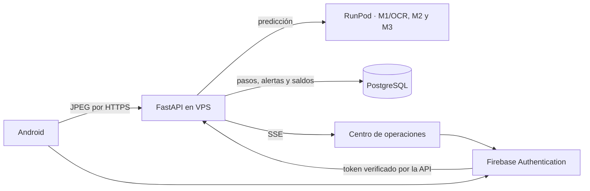

# Peaje La Paz
El proyecto une la captura Android, Google, la API, PostgreSQL, inferencia y el panel en vivo. La especificación del laboratorio está en docs/Especificacion.txt. Consulta STATUS.md para conocer las pruebas ejecutadas.
## Paquetes
El ZIP de código se descomprime en una sola carpeta en el VPS. El ZIP Llantas_para_revisar se importa como proyecto de puntos por llanta. El ZIP M3_piloto_revisado contiene cuatro recortes por vehículo para verificar el segundo esquema. Revisa datasets/revision_piloto.csv y datasets/ruedas_revisadas.json antes de entrenar.
## Prueba local reproducible
En Windows, instala las dependencias de api/requirements.txt en un entorno Python y ejecuta python tests/postgres_pilot.py. El script requiere PostgreSQL con initdb y pg_ctl. PG_BIN permite indicar la carpeta bin. Crea un clúster temporal con una contraseña aleatoria, lo detiene y lo elimina al salir. Usa registros DEMO. Las peticiones autenticadas de esta prueba usan un JWT local. Google necesita su prueba separada.
## Configuración del VPS
1. Apunta el registro DNS del subdominio al VPS. Habilita los puertos 80 y 443. Instala Docker y su complemento Compose.
2. Descomprime el código. Copia .env.example como .env en la misma carpeta que compose.yaml. Pon el subdominio sin https en DOMAIN. Genera por separado POSTGRES_PASSWORD y JWT_SECRET con openssl rand -hex 32. Usa permisos 600 para .env.
3. En Firebase habilita Authentication > Google. Añade el subdominio a los dominios autorizados. Registra la aplicación web y copia apiKey, authDomain y projectId a los tres campos NEXT_PUBLIC_FIREBASE correspondientes. Descarga la cuenta de servicio fuera de la carpeta pública y escribe su ruta absoluta en FIREBASE_ADMIN_FILE. Los archivos de cuenta de servicio son privados.
4. Ejecuta docker compose config --quiet y docker compose up -d --build. Verifica /api/v1/health y entra por la raíz del subdominio con una cuenta de la lista blanca. El docente queda registrado al iniciar. Para autorizar al operador, un ADMIN usa Administración > usuarios.
5. INFERENCE_URL debe ser la raíz HTTPS del proxy RunPod. INFERENCE_API_KEY debe coincidir en ambos servidores. QWEN_BASE_URL corresponde al endpoint compatible con OpenAI de tu workspace en Virginia; QWEN_API_KEY se configura solo en el backend.
## Modelos y RunPod
El notebook original trabaja por llanta con cinco puntos. La API de producción espera el M3 por vehículo de ocho puntos del Word. Usa training/Modelos_peaje_Colab.ipynb para M2/M3 una vez revisadas las máscaras y los centros, con train, val y test separados por secuencia.
Monta los pesos como /weights/m1.onnx (recuperado y probado) o /weights/m1.pt, además de /weights/m2.pt y /weights/m3.pt. M1 requiere el detector de placas de clase. M2 requiere las cinco categorías sin tildes. Construye la imagen desde la raíz del proyecto.
```sh
docker build -f inference/Dockerfile -t peaje-inferencia .
```
Expón HTTP 8000 y configura INFERENCE_API_KEY. Comprueba GET /health con X-Inference-Key. El servicio conserva review_required=true mientras falte una validación del perfil y los umbrales sobre fotos independientes. La confirmación explícita del operador está en POST /api/v1/pasos/{id}/confirmar. La evidencia original y la corrección quedan guardadas.
## Android
1. En Firebase registra la app Android bo.edu.peaje.lapaz. En mobile copia .env.example como .env. EXPO_PUBLIC_API_URL es la raíz HTTPS sin /api/v1. Usa la configuración pública de Firebase y el ID de cliente OAuth **web** en EXPO_PUBLIC_GOOGLE_WEB_CLIENT_ID. No incluyas claves de servidor.
2. Desde mobile, inicia sesión en Expo, vincula el proyecto con eas init y configura las mismas variables públicas en el entorno del build. Ejecuta eas build --platform android --profile preview. Revisa el costo o cuota que indique Expo antes de aceptar.
3. Obtén la huella SHA-1 del certificado de firma con eas credentials --platform android, añádela al cliente Android en Firebase/Google y verifica que corresponda al APK instalado. Abre el enlace del build en el teléfono e instala el APK.
4. Prueba Google autorizado y Google fuera de la lista. En Caseta concede cámara, elige la caseta y el sentido, e inicia captura con el vehículo de perfil. En Consulta usa placa, texto o foto. El panel debe mostrar el mismo paso y la misma evidencia.
## Evidencias para clase
Usa docs/openapi.json en Postman o Swagger Editor. Guarda resultados de casos reales antes de marcar las pruebas de la sección 15 del Word. Registra por separado errores de OCR, exactitud y MAE de ejes, porcentaje de revisión y latencias. En la demo muestra dos ángulos del mismo vehículo si una sola toma no permite leer placa y ruedas. La app procesa cada fotograma individualmente.


## Prueba local más reciente
Para probar los modelos juntos, descomprime Pesos_piloto.zip dentro de /weights en RunPod. Incluye el detector ONNX de Condra, lector CCT complementario, localizador de vehículos y los pesos piloto M2/M3. El servicio carga también EasyOCR. Con un fotograma local de minibús produjo categoría minibus y dos ejes en revisión. La fiabilidad en camiones sigue pendiente. Para continuar el entrenamiento en Colab usa M2_para_Colab.zip o M3_centros_para_Colab.zip con training/Modelos_peaje_Colab.ipynb.

## Arquitectura y servicios publicados

El panel está en https://srv2199251.hstgr.cloud y el monitor en https://srv2199251.hstgr.cloud/monitor. El endpoint de inferencia es https://rot1lab8bfnneh-8000.proxy.runpod.net/predict y requiere una clave en el servidor. La BD de pasos es PostgreSQL. Firebase gestiona el inicio de sesión. El diagnóstico y las métricas de la entrega están en docs/Verificacion_rubrica.md.

Para recrear el entorno de API usa Python 3.11, ejecuta `python -m venv .venv`, activa el entorno e instala `python -m pip install -r api/requirements.txt`. El entorno de inferencia se construye desde inference/Dockerfile. Web y Android usan sus package-lock.json con `npm ci`. Ejecuta training/diagnostico_entorno.py dentro de cada entorno Python para registrar las versiones realmente instaladas.

## Autoría y datos de entrenamiento

Cristian Manuél Nájera Mendoza es el único integrante y desarrollador del sistema. Se encargó de los datos, la visión artificial, la aplicación móvil, la API, el panel web y el despliegue.

El dataset propio contiene 300 fotografías originales y 279 imágenes únicas por SHA-256. El ZIP original y el inventario se incluyen en la carpeta de herramientas. El [proyecto privado de Roboflow](https://app.roboflow.com/manuls-workspace/peaje-la-paz-minibuses) contiene los originales únicos. Los archivos M2_para_Colab.zip y M3_centros_para_Colab.zip contienen los recortes y etiquetas utilizados en los pilotos.

## Reproducir el entorno de inferencia

En la plantilla de RunPod con Python 3.12 y CUDA 12.8, crear el entorno con `python -m venv .venv` y ejecutar:

```sh
. .venv/bin/activate
python -m pip install torch==2.8.0+cu128 torchvision==0.23.0+cu128 --index-url https://download.pytorch.org/whl/cu128
python -m pip install -r inference/requirements.txt
python training/diagnostico_entorno.py
```

Configurar MODEL_DIR y la credencial de inferencia en el entorno del servidor. Arrancar con `uvicorn inference.main:app --host 0.0.0.0 --port 8000`. En la aplicación móvil y web, npm ci instala las versiones de cada archivo package-lock.json. Las claves privadas permanecen en el servidor. Los archivos .env.example solo contienen nombres de variables.

La versión desplegada devuelve pasajeros como estimación geométrica basada en las máscaras de personas del vehículo objetivo. Los pasos históricos sin medición mantienen el valor nulo. Para la bonificación faltan métricas contra conteo humano y evidencia con varios pasajeros. Ver docs/Informe_tecnico.pdf para los resultados medidos.

## Caseta desde el navegador
Desde Android o iOS, abrir https://srv2199251.hstgr.cloud/movil en el navegador, iniciar sesión con Google, permitir cámara y pulsar Iniciar captura. La navegación superior conecta con Operaciones y Monitor. La caseta usa el mismo endpoint que Android y suspende la captura al ocultar la página.
